<div align="center">

# sd-computers

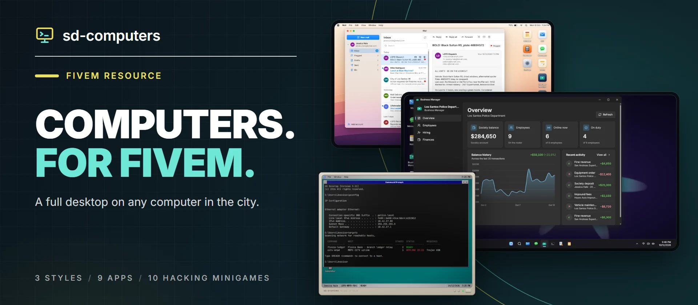

---

sd-computers puts a working desktop on any computer in your city. Players walk up to a configured location or prop, sign in and use real apps: Mail, an Event Viewer with that machine's own logs, a Command Prompt that launches hacking minigames, and a Business Manager for bosses. It runs on QBOX and QBCORE, and on ESX without the Business Manager.

Every computer opens in one of three original desktop styles, picked per computer. Admins place new computers in game with `/computeradmin`, without touching a config file.

The screen on the prop is real too. Sit down at a computer and the camera goes up to it: the desktop is inside the prop's own bezel, with the room still there around it. A computer nobody is using shows its lock screen, and one somebody is using shows what they are doing, live, to anyone standing nearby.

[](https://github.com/Samuels-Development/sd-computers)
[](https://discord.gg/FzPehMQaBQ)
[](https://docs.samueldev.shop)


[**Documentation**](https://docs.samueldev.shop) · [**Store**](https://fivem.samueldev.shop) · [**Discord**](https://discord.gg/FzPehMQaBQ)

</div>

---

## Support Me

If you're enjoying sd-computers and want to support my work, consider picking up a script from [Samuel's Development](https://fivem.samueldev.shop). Every purchase helps me keep building and improving resources like sd-computers. Browse Petty Crimes, Advanced Crafting, Horde, Smash Down, and more to find something for your server.

## Screenshots

Captured from the browser build using sample data. Click any image for the full 1920×1080 version.

**Jump to:** [SD OS Pro](#sd-os-pro-modern) · [SD OS Harbor](#sd-os-harbor-mac) · [SD Desktop 3.11](#sd-desktop-311-retro) · [Hacking minigames](#hacking-minigames) · [Admin panel](#admin-panel-computeradmin) · [Props](#props)

### SD OS Pro (`modern`)

A current desktop: centred taskbar, Start menu with search, rounded translucent windows, dark and light themes.

<p align="center"><a href="docs/previews/modern/desktop.webp">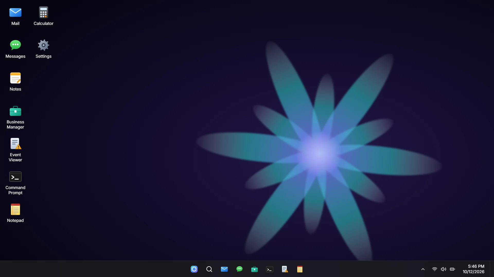</a></p>

<div align="center">
<table>
  <tr>
    <td align="center"><a href="docs/previews/modern/lock.webp">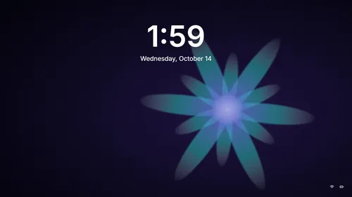</a><br /><sub>Lock screen</sub></td>
    <td align="center"><a href="docs/previews/modern/signin.webp">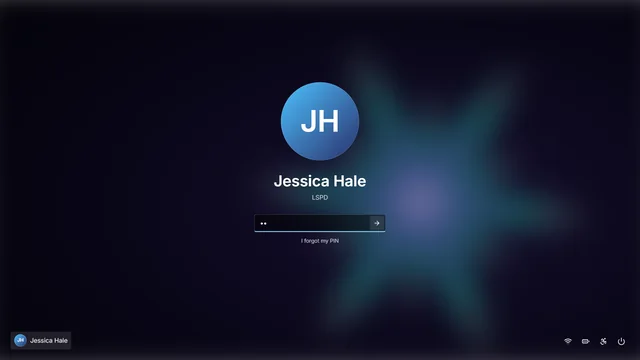</a><br /><sub>Sign in</sub></td>
    <td align="center"><a href="docs/previews/modern/start.webp">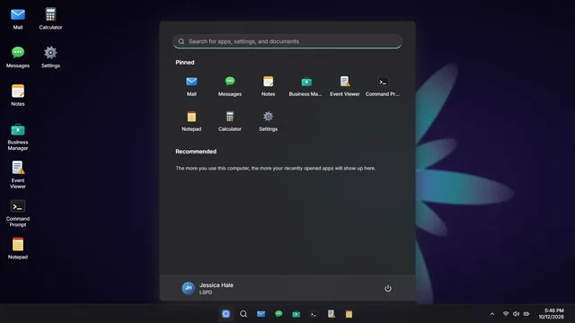</a><br /><sub>Start menu</sub></td>
  </tr>
  <tr>
    <td align="center"><a href="docs/previews/modern/mail.webp">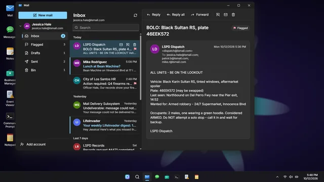</a><br /><sub>Mail</sub></td>
    <td align="center"><a href="docs/previews/modern/mail-compose.webp">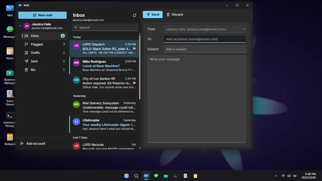</a><br /><sub>New mail</sub></td>
    <td align="center"><a href="docs/previews/modern/messages.webp">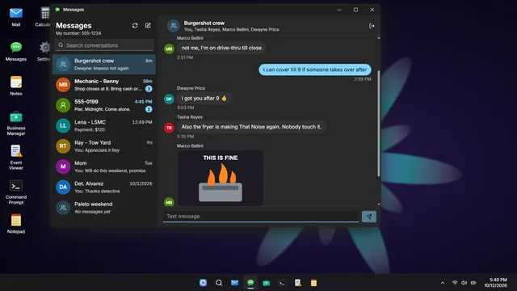</a><br /><sub>Messages</sub></td>
  </tr>
  <tr>
    <td align="center"><a href="docs/previews/modern/notes.webp">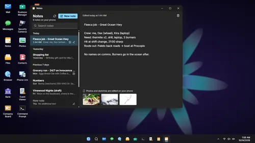</a><br /><sub>Notes</sub></td>
    <td align="center"><a href="docs/previews/modern/notepad.webp">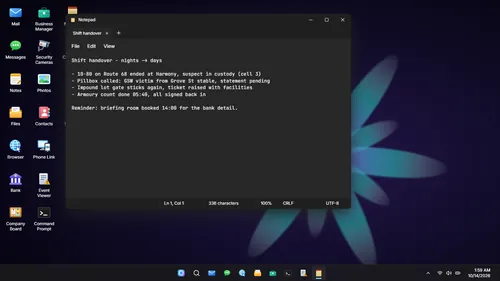</a><br /><sub>Notepad</sub></td>
    <td align="center"><a href="docs/previews/modern/boss.webp">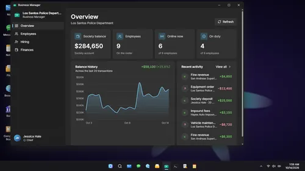</a><br /><sub>Business Manager</sub></td>
  </tr>
  <tr>
    <td align="center"><a href="docs/previews/modern/boss-employees.webp">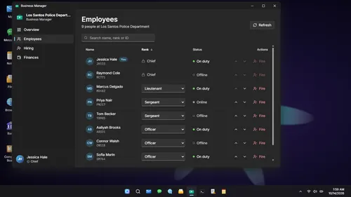</a><br /><sub>Employees</sub></td>
    <td align="center"><a href="docs/previews/modern/boss-hiring.webp">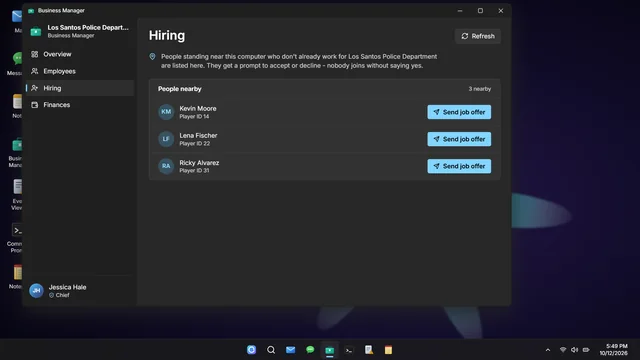</a><br /><sub>Hiring</sub></td>
    <td align="center"><a href="docs/previews/modern/boss-finances.webp">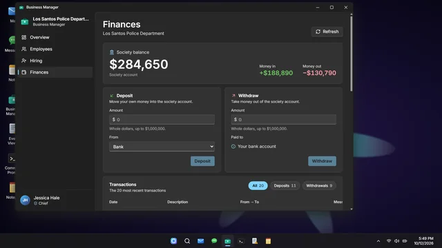</a><br /><sub>Finances</sub></td>
  </tr>
  <tr>
    <td align="center"><a href="docs/previews/modern/logs.webp">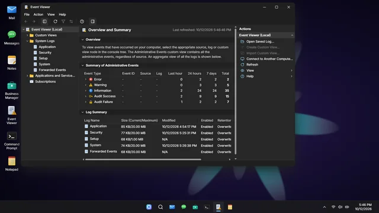</a><br /><sub>Event Viewer</sub></td>
    <td align="center"><a href="docs/previews/modern/logs-security.webp">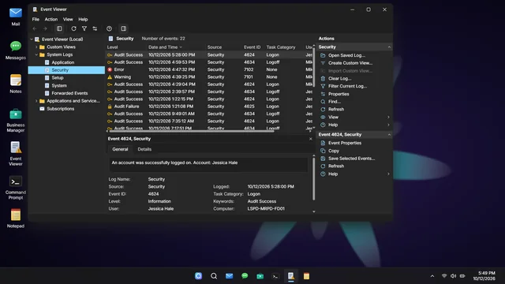</a><br /><sub>Security log</sub></td>
    <td align="center"><a href="docs/previews/modern/cmd.webp">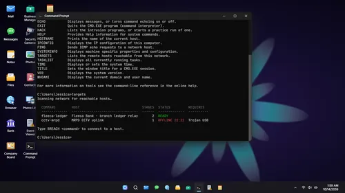</a><br /><sub>Command Prompt</sub></td>
  </tr>
  <tr>
    <td align="center"><a href="docs/previews/modern/calculator.webp">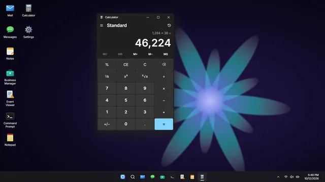</a><br /><sub>Calculator</sub></td>
    <td align="center"><a href="docs/previews/modern/settings.webp">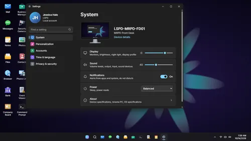</a><br /><sub>Settings</sub></td>
    <td align="center"><a href="docs/previews/modern/settings-personalization.webp">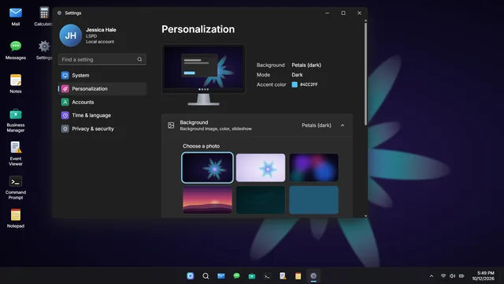</a><br /><sub>Personalization</sub></td>
  </tr>
</table>
</div>

### SD OS Harbor (`mac`)

Top menu bar, a magnifying dock, traffic-light window buttons and a search overlay.

<p align="center"><a href="docs/previews/mac/desktop.webp">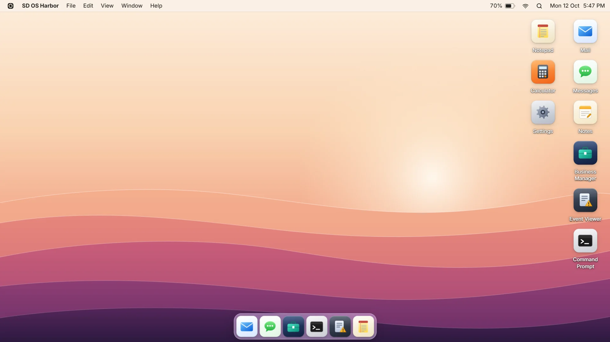</a></p>

<div align="center">
<table>
  <tr>
    <td align="center"><a href="docs/previews/mac/boot.webp"></a><br /><sub>Boot</sub></td>
    <td align="center"><a href="docs/previews/mac/lock.webp">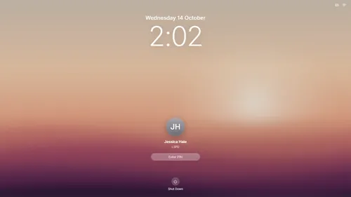</a><br /><sub>Lock screen</sub></td>
    <td align="center"><a href="docs/previews/mac/start.webp">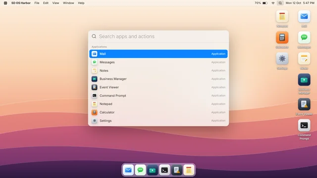</a><br /><sub>Search</sub></td>
  </tr>
  <tr>
    <td align="center"><a href="docs/previews/mac/mail.webp">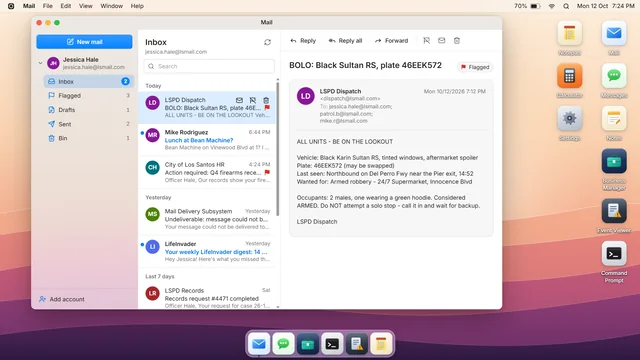</a><br /><sub>Mail</sub></td>
    <td align="center"><a href="docs/previews/mac/mail-compose.webp">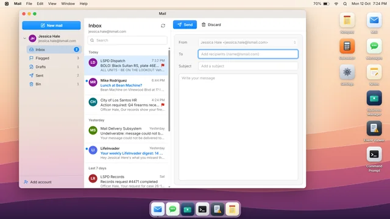</a><br /><sub>New mail</sub></td>
    <td align="center"><a href="docs/previews/mac/messages.webp">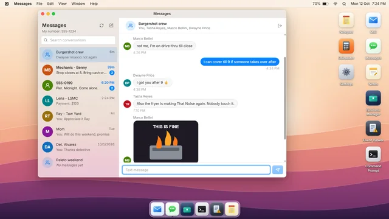</a><br /><sub>Messages</sub></td>
  </tr>
  <tr>
    <td align="center"><a href="docs/previews/mac/notes.webp">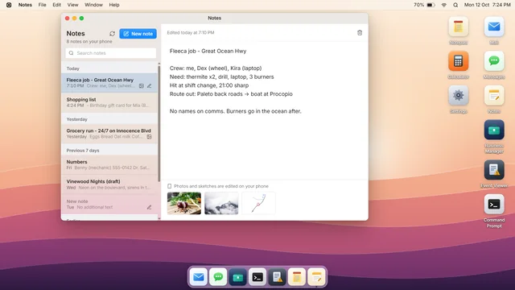</a><br /><sub>Notes</sub></td>
    <td align="center"><a href="docs/previews/mac/notepad.webp">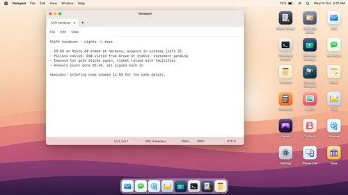</a><br /><sub>Notepad</sub></td>
    <td align="center"><a href="docs/previews/mac/boss.webp">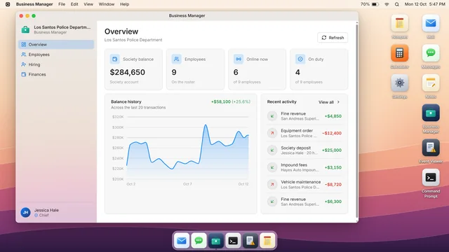</a><br /><sub>Business Manager</sub></td>
  </tr>
  <tr>
    <td align="center"><a href="docs/previews/mac/boss-employees.webp">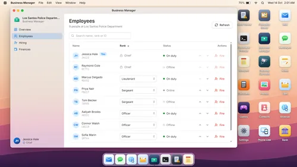</a><br /><sub>Employees</sub></td>
    <td align="center"><a href="docs/previews/mac/boss-hiring.webp">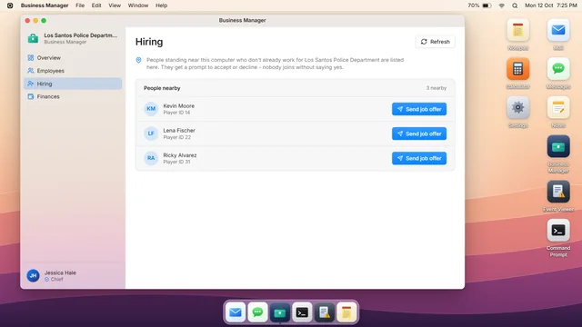</a><br /><sub>Hiring</sub></td>
    <td align="center"><a href="docs/previews/mac/boss-finances.webp">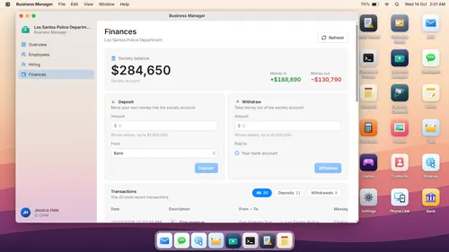</a><br /><sub>Finances</sub></td>
  </tr>
  <tr>
    <td align="center"><a href="docs/previews/mac/logs.webp">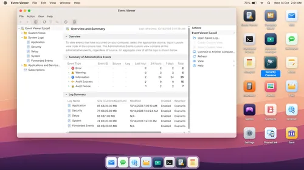</a><br /><sub>Event Viewer</sub></td>
    <td align="center"><a href="docs/previews/mac/logs-security.webp">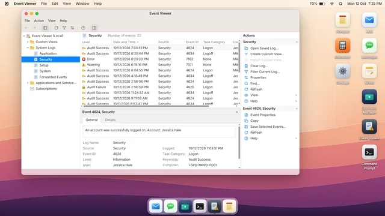</a><br /><sub>Security log</sub></td>
    <td align="center"><a href="docs/previews/mac/cmd.webp">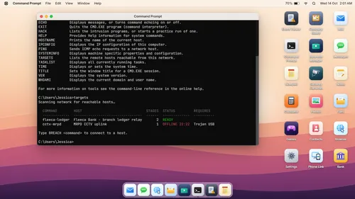</a><br /><sub>Command Prompt</sub></td>
  </tr>
  <tr>
    <td align="center"><a href="docs/previews/mac/calculator.webp">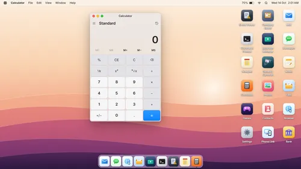</a><br /><sub>Calculator</sub></td>
    <td align="center"><a href="docs/previews/mac/settings.webp">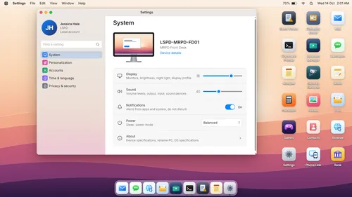</a><br /><sub>Settings</sub></td>
    <td align="center"><a href="docs/previews/mac/settings-personalization.webp">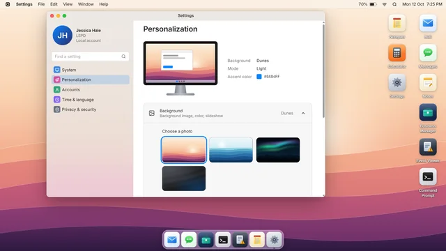</a><br /><sub>Personalization</sub></td>
  </tr>
</table>
</div>

### SD Desktop 3.11 (`retro`)

A 1991 shell inside a beige CRT: DOS boot, teal desktop, bevelled grey windows that snap open in chunky steps, and synthesized period sounds.

<p align="center"><a href="docs/previews/retro/desktop.webp">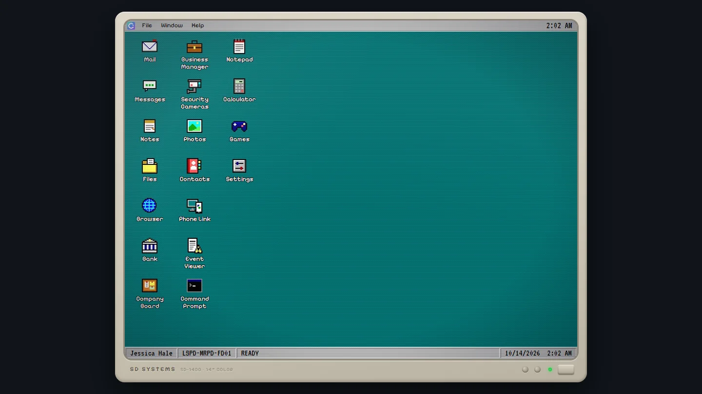</a></p>

<div align="center">
<table>
  <tr>
    <td align="center"><a href="docs/previews/retro/boot.webp">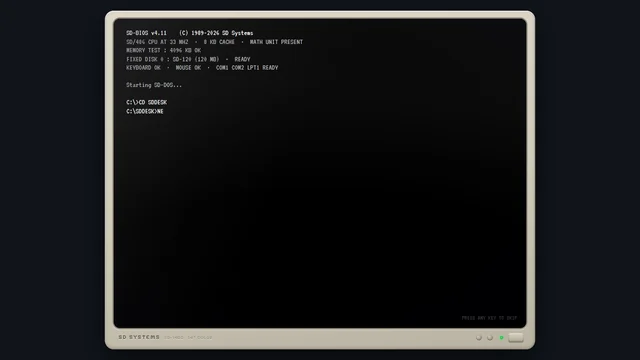</a><br /><sub>DOS boot</sub></td>
    <td align="center"><a href="docs/previews/retro/splash.webp">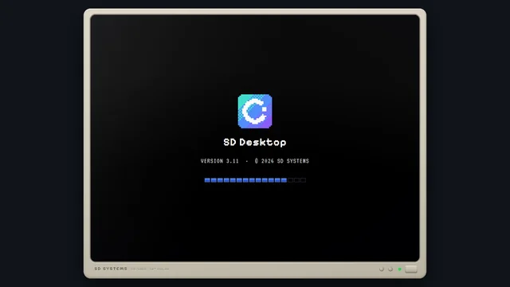</a><br /><sub>Splash</sub></td>
    <td align="center"><a href="docs/previews/retro/lock.webp">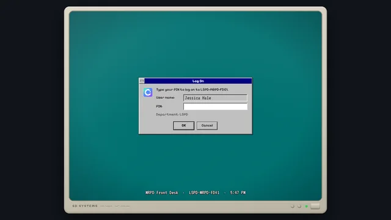</a><br /><sub>Log on</sub></td>
  </tr>
  <tr>
    <td align="center"><a href="docs/previews/retro/mail.webp">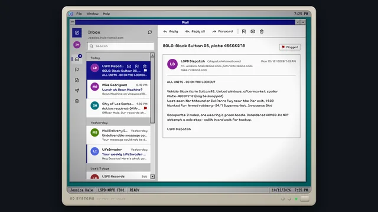</a><br /><sub>Mail</sub></td>
    <td align="center"><a href="docs/previews/retro/mail-compose.webp">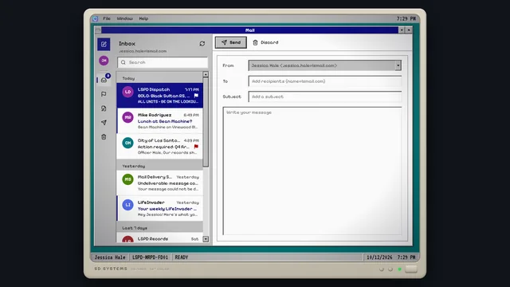</a><br /><sub>New mail</sub></td>
    <td align="center"><a href="docs/previews/retro/messages.webp">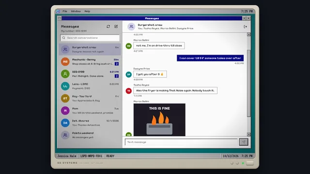</a><br /><sub>Messages</sub></td>
  </tr>
  <tr>
    <td align="center"><a href="docs/previews/retro/notes.webp">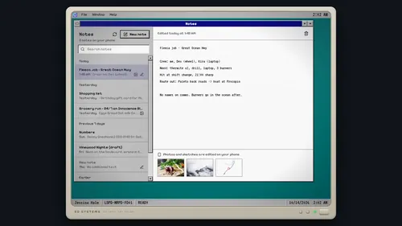</a><br /><sub>Notes</sub></td>
    <td align="center"><a href="docs/previews/retro/notepad.webp">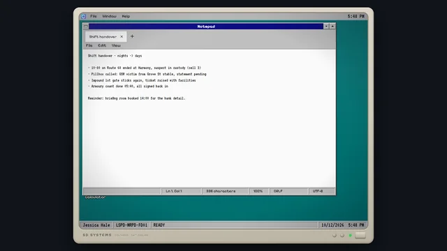</a><br /><sub>Notepad</sub></td>
    <td align="center"><a href="docs/previews/retro/boss.webp">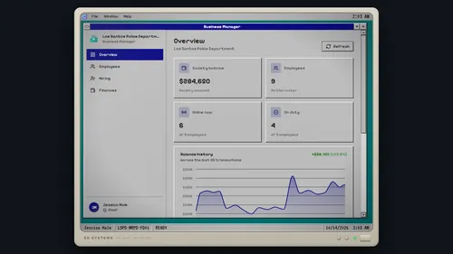</a><br /><sub>Business Manager</sub></td>
  </tr>
  <tr>
    <td align="center"><a href="docs/previews/retro/boss-employees.webp">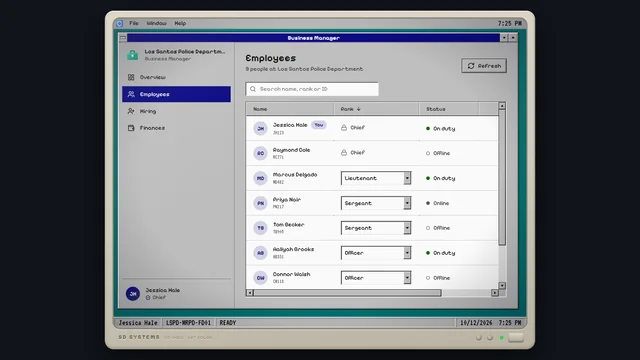</a><br /><sub>Employees</sub></td>
    <td align="center"><a href="docs/previews/retro/boss-hiring.webp">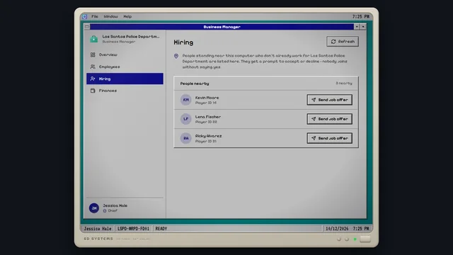</a><br /><sub>Hiring</sub></td>
    <td align="center"><a href="docs/previews/retro/boss-finances.webp"></a><br /><sub>Finances</sub></td>
  </tr>
  <tr>
    <td align="center"><a href="docs/previews/retro/logs.webp"></a><br /><sub>Event Viewer</sub></td>
    <td align="center"><a href="docs/previews/retro/logs-security.webp"></a><br /><sub>Security log</sub></td>
    <td align="center"><a href="docs/previews/retro/cmd.webp"></a><br /><sub>Command Prompt</sub></td>
  </tr>
  <tr>
    <td align="center"><a href="docs/previews/retro/calculator.webp"></a><br /><sub>Calculator</sub></td>
    <td align="center"><a href="docs/previews/retro/settings.webp"></a><br /><sub>Settings</sub></td>
    <td align="center"><a href="docs/previews/retro/settings-personalization.webp"></a><br /><sub>Personalization</sub></td>
  </tr>
</table>
</div>

### Hacking minigames

Ten minigames, launched from Command Prompt or from your own scripts. Shown here in SD OS Pro; the games are the same in every style.

<div align="center">
<table>
  <tr>
    <td align="center"><a href="docs/previews/hacking/maze.webp"></a><br /><sub>Network Maze</sub></td>
    <td align="center"><a href="docs/previews/hacking/capture.webp"></a><br /><sub>Node Capture</sub></td>
    <td align="center"><a href="docs/previews/hacking/cipher.webp"></a><br /><sub>Cipher Lock</sub></td>
  </tr>
  <tr>
    <td align="center"><a href="docs/previews/hacking/snake.webp"></a><br /><sub>Data Worm</sub></td>
    <td align="center"><a href="docs/previews/hacking/firewall.webp"></a><br /><sub>Firewall Defense</sub></td>
    <td align="center"><a href="docs/previews/hacking/evasion.webp"></a><br /><sub>Highway Evasion</sub></td>
  </tr>
  <tr>
    <td align="center"><a href="docs/previews/hacking/typing.webp"></a><br /><sub>Code Injection</sub></td>
    <td align="center"><a href="docs/previews/hacking/signal.webp"></a><br /><sub>Signal Replay</sub></td>
    <td align="center"><a href="docs/previews/hacking/pipe.webp"></a><br /><sub>Packet Routing</sub></td>
  </tr>
  <tr>
    <td align="center"><a href="docs/previews/hacking/breakout.webp"></a><br /><sub>ICE Breaker</sub></td>
    <td align="center"><a href="docs/previews/hacking/programs.webp"></a><br /><sub>Program list</sub></td>
    <td align="center"><a href="docs/previews/hacking/standalone.webp"></a><br /><sub>Standalone window</sub></td>
  </tr>
</table>
</div>

### Admin panel (`/computeradmin`)

Every computer on the server in one list, and the tool that places new ones.

<p align="center"><a href="docs/previews/admin/computers.webp"></a></p>

<div align="center">
<table>
  <tr>
    <td align="center"><a href="docs/previews/admin/overview.webp"></a><br /><sub>Overview</sub></td>
    <td align="center"><a href="docs/previews/admin/place.webp"></a><br /><sub>Place computer</sub></td>
    <td align="center"><a href="docs/previews/admin/place-retro.webp"></a><br /><sub>Prop and style</sub></td>
  </tr>
  <tr>
    <td align="center"><a href="docs/previews/admin/edit.webp"></a><br /><sub>Change computer</sub></td>
    <td align="center"><a href="docs/previews/admin/delete.webp"></a><br /><sub>Delete</sub></td>
    <td align="center"><a href="docs/previews/admin/placement-hud.webp"></a><br /><sub>Placement gizmo</sub></td>
  </tr>
  <tr>
    <td align="center"><a href="docs/previews/admin/styles-modern.webp"></a><br /><sub>Styles: SD OS Pro</sub></td>
    <td align="center"><a href="docs/previews/admin/styles-mac.webp"></a><br /><sub>Styles: SD OS Harbor</sub></td>
    <td align="center"><a href="docs/previews/admin/styles-retro.webp"></a><br /><sub>Styles: SD Desktop</sub></td>
  </tr>
</table>
</div>

### Props

Thirteen of the thirty-one props a computer can be placed as out of the box. Add any streamed prop in `configs/shared/admin.lua`, or from the panel itself.

<p align="center"><a href="docs/previews/props.webp"></a></p>

---

> [!TIP]
> **Running [sd-phone](https://github.com/Samuels-Development/sd-phone)? The computers pick it up.**
> A computer becomes another screen for the character's phone: Mail switches to the phone's own
> mailboxes, four more apps appear (Messages, Notes, Photos and Contacts), and Files and Bank show
> the phone's documents and banking history. Players link their phone to a machine with a code
> from the Phone Link app. sd-computers is complete without it.
> [More below](#sd-phone-link-optional).

## Apps

| | |
|---|---|
| **Mail** | Shared, password-protected `@lsmail.com` accounts (sign up, sign in, multiple accounts), inbox, flagged, drafts, sent, bin, reply and forward, bounces for unknown addresses, live new-mail toasts |
| **Event Viewer** | That computer's System Logs: sign-ins and failed PINs, lockouts, apps opened, mail sent, Business Manager actions, hack attempts and breaches, plus anything other resources write. Filterable; clearing it leaves a "log was cleared by X" entry (event 1102) |
| **Command Prompt** | A real-feeling `cmd.exe` (`ipconfig`, `systeminfo`, `ping`, `tasklist` and more) that launches the hacking minigames: free practice (`hack maze hard`) and configured breach targets (`targets`, `breach fleeca-ledger`) that pay rewards server-side |
| **Business Manager** | The boss menu: roster with online and on-duty status, promote, demote and fire, hire the players standing at the computer or anyone online by their player ID (they get an accept prompt either way), society balance chart, deposit and withdraw, statement. Only shown to that job's bosses |
| **Files** | The character's documents: written on any computer, they follow the character to every other one. With sd-phone, the phone's documents show beside them |
| **Browser** | A closed, in-game network: the sites you list in `configs/shared/browser.lua`. With sd-phone those are the city's own, live: Weazel News, the Marketplace, the Yellow Pages, a business directory, Squawk, the penal code and the stock market. You can also write pages right in the config, or embed your own web page. Any other address "can't be reached" |
| **Bank** | The character's bank balance, cash and recent transactions, to look at. Nothing can be moved from it |
| **Company Board** | A job's notice board: bosses post, pin and remove announcements, everyone in the job reads them from any computer, and it shows who is on duty. Only shown to players with a job |
| **Security Cameras** | The cameras a player is allowed to watch from that computer: the ones put up from the admin panel, and the ones in `configs/shared/cameras.lua`. Picking one plays its picture live in the app's window, to look around and zoom with, and **Full screen** puts it over the whole display. Only shown to players with at least one camera to watch; every first look is written to the System Logs |
| **Print** | Notepad, Files, Mail, Bank and Event Viewer print to a [printer](#printers) near the computer. The page waits in the printer's tray and is taken as an item that opens as the page |
| **Games** | A shelf of three, each one a program of its own with its own window, icon and look: Mines on a bomb-disposal console, Solitaire on a felt card table, Snake on an arcade screen. Best results are kept |
| **Phone Link** | Only with sd-phone: links the character's phone to that machine. It sends a code to the phone as a notification; typing it in puts the phone's apps on the desktop there and then, until they unlink it |
| **Messages / Notes / Photos / Contacts** | Only with sd-phone, once the phone is linked in Phone Link: the phone's texts, notes, gallery and address book on the desktop |
| **Notepad / Calculator / Settings** | Notes that follow the character to every computer; a full standard calculator; wallpaper, accent colour and dark or light mode, saved per character |

Around the apps: a lock screen with an optional per-computer PIN (checked server-side, with lockout), welcome and shutdown screens, draggable, resizable, snap-to-maximize windows, calendar and quick-settings flyouts, toast notifications, and system sounds for starting up, signing in, windows, clicks and notifications (synthesized, no audio files; each style has its own and can switch them off).

## Three looks, one computer

Every computer runs the same apps against the same server. Its **style** decides the shell around them:

| Style | Name on screen | Feel |
|---|---|---|
| `modern` | SD OS Pro | Centred taskbar and Start menu, rounded translucent windows, dark or light, soft glassy system sounds |
| `retro` | SD Desktop 3.11 | A 1991 shell inside a beige CRT: DOS boot, teal desktop, bevelled grey windows that snap open in chunky steps, synthesized period sounds |
| `mac` | SD OS Harbor | Top menu bar, magnifying dock, traffic-light window buttons, search overlay, a startup chord and its own pops and whooshes |

Pick it per computer with `style = 'retro'` in `configs/shared/computers.lua` (unset = `Desktop.DefaultStyle`), or force it per open from a script:

```lua
exports['sd-computers']:OpenComputer(id, coords, { style = 'mac' })
```

Each style has its own OS name, wallpapers and accent palette (`Desktop.Styles`), and every character's wallpaper, accent and light or dark choice is saved **per style**. All three are original designs: no real OS logos, names, wallpapers or fonts.

## At the screen

Using a computer does not cover the game with a desktop. The camera moves up to the prop, square on to its screen, and the desktop sits exactly inside it: the monitor's bezel or the laptop's lid is the frame, and the room is still there around it. Mouse and keyboard work as they always did.

- The desktop keeps its own resolution and takes the shape of the screen it is on, so it is the same desktop on a 720p display and a 4K one, on a square monitor and a wide laptop.
- Retro leaves its drawn CRT off there: the prop is the monitor.
- A computer with no screen to go to opens fullscreen, as before: a tower PC, a zone with no monitor standing in it, a laptop opened from a script with no prop (`OpenComputer` without coords).
- `configs/shared/interact.lua`: `View = 'screen'` (default) or `'fullscreen'` for every computer, and `Camera` for the framing (`Fill`, how much of the window the screen takes), the field of view and how long the camera takes to travel.
- Watching a security camera has the game look through that camera, so for as long as one is watched the room round the screen is a still picture of how it was. It moves again when the player goes back to the list of cameras.

## Screens in the world

A computer's prop shows its screen to everyone around it (`configs/shared/screens.lua`, on by default):

| The computer is | Its screen shows |
|---|---|
| Not in use | The lock face of its style: wallpaper and clock |
| In use | A live copy of the session: the windows that are open, what is being typed, the pointer, the hacking minigames |

Walk past a desk and you can see that someone is in Command Prompt, read the mail they have open, or watch a breach in progress. PIN and password fields are always masked, and the `/computeradmin` panel is never part of the picture.

- **Which props:** the monitors and laptops in `Screens.Models`. Tower PCs have no screen and are left alone. A location computer (a box zone) shows on the screen prop standing inside its zone, when there is one.
- **Your own props:** draw the screen on the prop with the panel's screen tool ([Drawing a prop's screen](#drawing-a-props-screen)), or add an entry to `Screens.Models` by hand with where the screen is on the model: its `centre`, its `size`, and for a lid or a stand its `tilt`. A model with neither gets no screen.
- **What it costs:** each screen is a small browser drawn on the prop. Every idle screen of a style shares one, so an office full of monitors is three at most. A computer in use gets one of its own, for the nearest `MaxLive` (3). The player at the computer only records while somebody is actually watching, and what travels is the page's changes, not video: a few KB when a window opens, next to nothing while they read.
- **Switches:** `Enabled = false` turns screens off entirely. `Idle = 'off'` leaves unused props alone and lights only the ones in use. `Mirror.Enabled = false` keeps a computer in use on its lock face, so nothing of a session ever leaves the player's game.

There is no sound, and the copy runs a fraction of a second behind.

## Hacking

Command Prompt is the way into the minigames:

| Command | What it does |
|---|---|
| `hack` | Lists the programs |
| `hack <program> [easy\|medium\|hard]` | A practice run. Logged, no reward |
| `targets` | The hosts reachable from this computer, with their stages, status and item requirement |
| `breach <command>` | Every stage of a target, in order. The server pays the reward |

| Key | Program | Game |
|---|---|---|
| `maze` | net-maze.exe | Network Maze |
| `capture` | node-grab.exe | Node Capture |
| `cipher` | cipher-lock.exe | Cipher Lock |
| `snake` | data-worm.exe | Data Worm |
| `firewall` | fw-defense.exe | Firewall Defense |
| `evasion` | highway-evade.exe | Highway Evasion |
| `typing` | code-inject.exe | Code Injection |
| `signal` | sig-replay.exe | Signal Replay |
| `pipe` | pipe-route.exe | Packet Routing |
| `breakout` | ice-break.exe | ICE Breaker |

The minigames come from sd-deaddrop, with the same server-side anti-cheat: proof-of-play floors, ordered milestones and server-seeded puzzles. Breach targets live in `configs/server/targets.lua`: which computers, the minigame steps, item requirement, cooldowns, police alert and rewards (items, money, mail or your own server event).

## Admin panel

`/computeradmin` (admins) opens a panel listing every computer on the server, who is sitting at which, its style and its job lock, and places new ones without touching a config file:

1. **Place computer**: pick the prop it stands as (`configs/shared/admin.lua` > `Props`), the style it opens in (`modern`, `retro`, `mac`, or the server default), a name, and optionally the jobs that may use it and who gets the Business Manager on it.
2. The placement gizmo takes over, the same one sd-bombs and sd-scooters use. The prop starts sitting on whatever you were looking at; move and turn it, **Enter** places it.
3. It is live at once for everyone, with the same "Use Computer" option as any other computer.

A placed computer can be changed (name, prop, style, jobs, Business Manager), moved with the gizmo, teleported to and deleted from its row. Computers from `configs/shared/computers.lua` cannot be changed there, but a location from that file can be removed from its row and restored again: the file is not touched, the computer just stops being one (nobody can open it, and its monitor goes back to its stock look) until it is restored. Placed ones are kept in the `computers_placed` table and get the ids `placed_<n>`, which is what keys their System Logs.

### Security cameras from the panel

The **Cameras** tab lists every security camera, with the jobs that may watch it, and puts new ones up in game:

1. **Put up a camera**: give it a name, the heading the app lists it under, and optionally the jobs (or gangs) that may watch it, each with a minimum grade. No jobs listed means anyone sitting at a computer can watch it.
2. A free camera takes over. Fly it to where the camera should hang (**W A S D**, **Space** and **Ctrl** for height, **Shift** faster, **Alt** slower), aim with the mouse and zoom with the wheel. What is on the display is what the camera will show; **Enter** keeps it, **Backspace** cancels.
3. It is in the Security Cameras app at once, for the players it is for.

A camera put up this way can be renamed, given to other jobs, moved or aimed again, gone to and taken down from its row. The ones `configs/shared/cameras.lua` lists show in the tab too and can be removed and restored there; the file is not touched. Cameras put up from the panel are kept in the `computers_cameras` table.

### Business Manager on a placed computer

The same dialog decides who gets the Business Manager on a computer made from the panel, which is what `boss` does for an entry of `computers.lua`:

- **Off**: nobody manages a job from it.
- **Any boss**: whoever signs in as the boss of a job manages that job (`boss = true`). Good for a shared laptop.
- **One job**: only that job's boss gets it (`boss = 'police'`). Type the job as your framework spells it, or pick it from the list of the server's jobs under the field.

The line under it says in plain words who gets the app, and warns when nobody would: the server has no job of that name, the job has no boss grade, or the job lock leaves that job out (one click adds it). A job that does not exist yet can still be saved; the app shows up once it does. Changing the setting signs out whoever is using that computer, so it applies at once. Every row of the list shows a briefcase with the job (or "Any boss") when a computer has the Business Manager, the ones from the config included.

### Props the game already has

**Pick existing prop** makes a computer of a monitor or laptop that is already in the world, instead of standing a new one: set its name, style and jobs, then aim at the prop (it is boxed while you look at it) and press **Enter** or click. Nothing is spawned. The prop becomes a computer of its own, like a placed one, and stops being the automatic computer its model would otherwise make it. It keeps its prop and its spot; delete it to give the prop back. Any model in `Props` or in a `model` list of `computers.lua` can be picked.

The **Automatic** tab is the `model` computers of `computers.lua`, the ones that make every prop of a model a computer wherever the game has one. They are **off out of the box**: a computer is one you placed or picked (or a location in `computers.lua`) until you switch them on here.

- one switch for all of them: off, and no prop in the world is a computer unless you placed or picked it. It starts where `Automatic` in `configs/shared/admin.lua` has it (`false`);
- one switch for each model computer;
- a tick for every prop, so "flat monitors yes, the CRT no" is one click. A prop from `Props` that no `model` list names shows as an extra one any of them can take on;
- a style for each model computer, and one of its own for any prop of it: the CRT can open in the retro desktop while every other monitor stays modern. The lock face on the prop follows.

What the panel changes is kept in the database (`computers_settings`) and wins over the file; a prop nobody touched still follows the file, and a prop left on "Same as computer" follows its computer's style. The switches decide which props offer a computer and show a screen. They are not a lock: an entry that is switched off still opens for a script through `OpenComputer`, so use `groups` to keep people out of one.

Permissions are aces, like sd-bombs: `Group` (default `group.admin`) gets the command and the edit ace `sd_computers.edit`; an optional `ViewGroup` can open the panel but not change anything. To let another principal edit:

```cfg
add_ace group.mod command.computeradmin allow
add_ace group.mod sd_computers.edit allow
```

### Your own props

The **Props** tab is the catalogue of every prop a computer can be, each with where it is in use. **Add prop** there (also the last tile of the prop grid when placing) adds a prop model to the list without editing a file: its model name, what to call it and whether it is a monitor, a tower or a laptop. The game is asked whether the model exists before it is kept, so a streamed prop works as long as it is running. The list ships with monitors and laptops only: tower PCs have no screen, so they are left out by default (they are commented out in `configs/shared/admin.lua` > `Props`, and can be added here like any other prop). From then on a computer can be placed as it, one can be picked from the world, and the Automatic tab offers it to every model computer as an extra. Props added this way are kept in the database and can be removed from their tile in the Props tab (not while a computer is placed as one).

A prop only has a screen drawn on it, and the camera going up to it, when the resource knows where its screen is. Without that it is still a computer; it opens fullscreen. `configs/shared/screens.lua` has a rectangle for every prop on the list, and for a number of props that are the same shape as one of them with something else on screen (other DLC laptops, the seven control room monitors), so adding one of those from the panel gets its screen at once. For any other prop, draw it.

### Drawing a prop's screen

Every tile in the **Props** tab has a screen button: **Draw screen** on a prop that has none (it is marked "No screen"), **Adjust screen** on one that has. It opens the screen tool: the prop is shown on its own in front of a plain backdrop, and you draw where its screen is with the mouse, with the lock screen shown in the box exactly as players will see it.

| Do this | With |
| --- | --- |
| Draw the screen, corner to corner; then drag its middle to move it, an edge or corner to resize it | Left mouse button |
| Push it into the prop or pull it out, until it sits on the glass | Mouse wheel (Shift: bigger steps) |
| Lean it back for a laptop lid or a monitor on a stand | Q / E |
| Nudge it a millimetre | Arrow keys |
| Sit it on the prop's surface (a first guess: as good as the prop's collision) | G |
| Look at it from any side; front view; side view | Hold right mouse button; F; V |
| Zoom; hide the picture to see the prop's own glass; put the screen on another side of the prop | Ctrl + wheel; H; R |
| Undo; start over; copy it as a line for `screens.lua` | Ctrl + Z; Del; C |
| Save; cancel | Enter; Backspace |

A screen is a flat rectangle, so curved glass gets the nearest flat one. What you draw is kept in the database (`computers_settings`) and applies to every prop of that model for everyone at once. It wins over the rectangle `screens.lua` has for the same model, so a built-in screen that sits a little off can be redrawn too; the arrow button beside **Adjust screen** takes a drawn screen away again.

## Printers

Stand a printer near a computer and its apps can print. A page is not handed to whoever pressed Print: it comes out of the printer, and waits in its tray until somebody walks over and takes it.

- **Printing.** Notepad (File > Print, or Ctrl+P), Files, Mail, Bank and Event Viewer each have a Print. It lists the printers within reach of that computer (`Range`, 30 m), nearest first, and asks how many copies.
- **Taking the pages.** Target the printer and take what is in its tray. Each copy takes a moment to come out (`PageSeconds`). Anyone standing there can take them unless `OwnOnly` is set, a full tray prints nothing more (`TrayLimit`), and what nobody collects is thrown away after an hour (`TrayMinutes`).
- **The item.** A printout is one inventory item, `printed_document`. Its tooltip says what the page is, who printed it, when and from which machine; using it holds the page up to read. Copies of the same page stack, and it can be handed over, stashed or found on somebody like any other item.
- **What a page is.** A typed page is plain. A mail message prints with its headers, a bank statement with the bank's letterhead and its rows, a system log on green-bar listing paper. Those three are built by the server from its own data, never from what the page sent, so nobody can print a statement that says something the bank does not.

Every print is written to that computer's System Logs (event 5001, source Print Spooler).

### Printers from the panel

The **Printers** tab of `/computeradmin` lists every printer with what is waiting in its tray:

1. **Place a printer**: name it, pick the prop (`configs/shared/printers.lua` > `Props`), and stand it with the placement gizmo, on a desk or the floor.
2. Or **Pick existing prop**: aim at a printer or copier the game already has in the world. Nothing is spawned; that prop becomes the printer.

A printer can be renamed, moved, gone to and removed from its row. Removing one throws away what was in its tray. They are kept in the `computers_printers` table, the pages in `computers_prints`.

## sd-phone link (optional)

sd-computers is complete on its own. If **[sd-phone](https://github.com/Samuels-Development/sd-phone)** is running too, a computer becomes another screen for the character's phone:

| | With sd-phone | Without |
|---|---|---|
| **Mail** | The phone's mail: the same `@lifeinvader.com` accounts, inbox (plus Spam), attachments, phone notifications and badges | Built-in `@lsmail.com` Mail |
| **Messages** | New app: the phone's text threads. Read, reply, start a thread to a number or contact; incoming texts toast on the desktop | Not installed |
| **Notes** | New app: the phone's notes. Edit the text, view their photos and sketches | Not installed |
| **Photos** | New app: the phone's gallery, to look at | Not installed |
| **Contacts** | New app: the phone's address book. Add and remove contacts, and message one straight from it | Not installed |
| **Files** | Also lists the phone's documents | The character's own documents only |
| **Bank** | Takes its statement from the phone's banking history | The banking resource's statement, when it keeps one |
| **Phone Link** | New app: links the phone to the machine with a code | Not installed |
| **Browser** | The phone's public apps as sites, live (below) | Only the pages written in the config |

**Linking a phone.** Messages, Notes, Photos, Contacts and the phone's documents in Files are not on a computer until the character has linked their phone to that machine. They open **Phone Link**, send a code to their phone (it arrives as a notification, so they need the phone on them), and type the six digits in. The phone's apps appear on the desktop straight away and stay for that character on that machine until they press **Unlink**. Every machine is linked on its own: one public PC being linked says nothing about the next one. A code works for `LinkCodeMinutes` (5), five wrong tries use it up, and a new one can be sent every 30 seconds. `RequireLink = false` drops the code and the app, and the phone's apps are simply there. Mail and the Bank statement do not wait for the link.

- Needs sd-phone's link file `server/compat/computers.lua` (shipped with sd-phone, one line in its fxmanifest). It runs the phone's own handlers, so a text sent from a desk validates, notifies and threads exactly like one typed on the phone.
- Detected live: start or stop sd-phone at any time and the next computer you open follows. An sd-phone without the link file is treated as "not installed" (one console warning).
- `configs/shared/phone.lua`: `Enabled` (`'auto'` / `false`), a switch for each of `Mail`, `Messages`, `Notes`, `Photos`, `Contacts`, `Files` and `Bank`, `RequireLink` and `LinkCodeMinutes` (above), and `RequirePhone` (the four phone apps only for players carrying a phone, default on - with `RequireLink`, whether a machine that is already linked still needs the phone nearby).
- Per computer: `phone = false` in `computers.lua` keeps the four phone apps and Phone Link off that machine (a police terminal, say). Mail follows the server-wide switch so nobody sees two different inboxes.
- `SendMail`, `MailAddressExists` and `GetMailAddresses` follow the switch too: while linked they work on the phone's mailboxes (the ones players actually read).
- sd-phone side: `set sd_phone_computerlink "sd-computers"` lists the resources allowed to drive the link (default sd-computers only; `"off"` disables it).

**The city's sites in the Browser.** With sd-phone's link at v2 or newer, the Browser shows the phone's public apps as websites. Each is one line in `configs/shared/browser.lua` (`live = '...'`), so the address and the name are yours and a site you do not want is a line taken out:

| `live` | Site (default address) | What a player can do |
|---|---|---|
| `news` | Weazel News (`weazel.news`) | Read the breaking line and every story. Players the phone counts as Weazel staff get a **Newsroom**: write, edit, feature, publish now or later, take down, and set the breaking line |
| `market` | Marketplace (`marketplace.ls`) | Browse and search listings with photos, price and the seller's contact. Put up, edit and take down their own |
| `pages` | Yellow Pages (`yellowpages.ls`) | The same for adverts |
| `directory` | Business Directory (`directory.ls`) | See every company and whether anybody is on duty, and write to one (the answer comes to their phone) |
| `squawk` | Squawk (`squawk.ls`) | Read the public feed, what is trending, a hashtag and anybody's page |
| `laws` | Laws and Fines (`laws.gov`) | Look up any charge: its fine and its sentence, as the police terminal has them today |
| `stocks` | Stock Market (`stocks.ls`) | Watch prices and charts. Only while the phone's Stocks app is switched on |

- Reading needs no phone and no Phone Link: these are public pages, and they work at any computer that has the Browser. They refresh themselves while they are being looked at.
- Posting is done as the player at the desk, through the phone's own action for it: its limits, its "is this yours" check and its staff rule are the ones that hold, and a refusal comes back as the phone's own sentence.
- A photo on a post has to come out of the poster's phone gallery (the phone takes nothing else), so the photo picker is only there while their phone is linked to that computer. The **Message** and **Email** buttons on an ad open the computer's Messages and Mail, so Message needs the link too.
- A site whose app is switched off in sd-phone, or an sd-phone with an older link, simply leaves that site off the network. Scheduling an ad for later stays on the phone.
- The penal code is open to everyone here, though on the phone only police and DOJ terminals show it. Take the `laws` line out if you would rather it stayed that way.

## For developers

### Server exports

```lua
-- Run a hack on a player and get a VERIFIED result (yields until they win, lose or quit).
local won = exports['sd-computers']:RunHack(source, 'maze', 'hard')

-- Or let the client run it (StartHack below) and redeem the proof it returns. One-shot, expires.
local info = exports['sd-computers']:ConsumeHackProof(source, proof, { game = 'maze', difficulty = 'medium' })
-- info = { game, difficulty, elapsed } or false

-- Write to a computer's System Logs (computer id, or '<id>@x,y,z' for one specific prop).
exports['sd-computers']:AddLog('mrpd_frontdesk', 'warning', 'sd-doors', 'Evidence locker opened', { by = 'Officer Hale' })

-- System / NPC mail (no sent copy, no bounce).
exports['sd-computers']:SendMail({ to = 'jessica.hale@lsmail.com', subject = 'Shift starts', body = 'See you at 8.', from = { name = 'LSPD HR', email = 'hr' } })
exports['sd-computers']:MailAddressExists('jessica.hale@lsmail.com')
exports['sd-computers']:GetMailAddresses(citizenid) -- addresses a character is signed into

exports['sd-computers']:GetComputers() -- { id, label, hostname, coords?, model?, placed?, prop?, world? }[] (placed = from the admin panel; world = a prop the game already had, picked)

-- Printing: a page of your own. A page is { title, letterhead?, subhead?, fields? = { { label, value } }, body?, table? = { head, rows }, image?, footer?, kind? }.
exports['sd-computers']:GetPrinters() -- { id, label, coords }[]
local ok, why = exports['sd-computers']:PrintAt(printerId, page, { copies = 1, by = 'Officer Hale', from = 'Records' }) -- into that printer's tray
local ok, why = exports['sd-computers']:GivePrintout(source, page, { copies = 1 }) -- straight into a player's inventory
```

Fired after every successful breach, with `info = { target, computer, instance }` (each target can also name its own event):

```lua
AddEventHandler('sd-computers:server:breachCompleted', function(src, info) end)
```

### Client exports

```lua
-- Open a computer from another script (a laptop item, a phone app...). Model computers take the
-- prop's coords (default: the player's position, e.g. a held laptop). Server rules still apply.
-- Optional third argument forces a style for this open.
exports['sd-computers']:OpenComputer('business_laptop')
exports['sd-computers']:OpenComputer('public_pc', nil, { style = 'retro' })

-- Standalone hack.exe window (no computer needed). Redeem the proof on the server!
local won, proof = exports['sd-computers']:StartHack({ game = 'pipe', difficulty = 'medium', title = 'Vault Door' })
```

## Compatibility

| Layer | Supported |
|---|---|
| Frameworks | QBox, QBCore. ESX works for everything except the Business Manager, which hides itself |
| Target | ox_target, qb-target, qtarget |
| Society funds | sd-banking, Renewed-Banking (optional; the Finances tab hides without one) |
| Phone | sd-phone (optional) |

## Installation

### Dependencies

| Resource | What it is for |
| --- | --- |
| [ox_lib](https://github.com/CommunityOx/ox_lib) | Shared library |
| [oxmysql](https://github.com/CommunityOx/oxmysql) | Database access |
| A target resource | `ox_target`, `qb-target` or `qtarget`, for the "Use Computer" option |

### 1. Start the resource

Drop `sd-computers` into your resources folder and start it after ox_lib, oxmysql, your framework, your target and your banking:

```cfg
ensure ox_lib
ensure oxmysql
ensure sd-computers
```

Database tables create themselves on first boot: `computers_profiles`, `computers_logs`, `computers_placed`, `computers_settings`, `computers_mail_accounts`, `computers_mail_sessions`, `computers_mail_messages`, and one each for the features that keep one (`computers_files`, `computers_cameras`, `computers_printers`, `computers_prints` ...).

The UI ships pre-built in `web/build`, so a plain download or clone runs as is.

### 2. Set up your computers

Computers come from two places, and you can use both:

- `configs/shared/computers.lua`: each entry is a location (`coords` / `size` / `rotation`) or a `model` (every prop of that model in the world).
- `/computeradmin` in game: place one on any desk, or pick a monitor the game already has, and it is live at once. The same panel switches the `model` computers on and off, prop by prop.

The `model` computers are off until you switch them on: out of the box the monitors and laptops around the map are not computers, only the locations in `computers.lua` and the ones you place or pick are. To make every prop of the listed models a computer, flip the switch at the top of the panel's **Automatic** tab, or set `Automatic = true` in `configs/shared/admin.lua`.

The example coordinates (MRPD front desk, Pillbox reception) are from qbx_police and qbx_ambulancejob; check them in game. With `Debug = true`, aim at a keyboard and run `/computer_pos`: it copies a ready-made `coords = vec3(...)` line.

### 3. Set your breach targets, and PINs if you want them

Both live in `configs/server/`, which never ships to clients: breach targets and their rewards in `targets.lua`, and optional PINs per computer in `security.lua`. No computer has a PIN out of the box: a computer's `groups` already decides who can use it, and only those players are offered it.

### 4. Add the printout item

Printers hand out an item, so your inventory has to know it. The name is `Item` in `configs/shared/printers.lua`; its picture is `docs/items/printed_document.png`, to copy into your inventory's images folder.

ox_inventory (`data/items.lua`):

```lua
['printed_document'] = {
    label = 'Printed page',
    weight = 5,
    stack = true,
    close = true,
    consume = 0,
    description = 'A page from a printer.',
    server = { export = 'sd-computers.usePrinted_document' },
},
```

qb-core (`shared/items.lua`):

```lua
printed_document = { name = 'printed_document', label = 'Printed page', weight = 5, type = 'item', image = 'printed_document.png', unique = true, useable = true, shouldClose = true, description = 'A page from a printer.' },
```

Until the item exists, the Printers tab of the admin panel says so, and so does the server console at boot. No printers on your server? Skip this, or set `Enabled = false` in that file.

## Configuration

Scope-by-folder, like the other sd-* resources: `configs/shared` ships to clients, `configs/server` never does.

| File | What's in it |
| --- | --- |
| `configs/config.lua` | Locale, Debug, bridge debug prints |
| `configs/shared/computers.lua` | **The computers.** Each is a location (`coords`/`size`/`rotation`) or a `model` (every prop of that model). Optional `groups` lock, `boss` (a job name, or `true` = the signed-in player's own job), `style`, `apps` list |
| `configs/shared/desktop.lua` | Default style, app list and window sizes, default apps, pins, desktop icons, 12/24h clock, and per style (`Styles`): OS name and build, wallpapers, accent colours, default theme, a `Sounds` toggle for its system sounds, retro's CRT monitor |
| `configs/shared/interact.lua` | Target label, icon and distance, walk-away distance, **how the desktop is shown** (the camera up at the prop's screen, or fullscreen) and that camera's framing, typing animation, debug `/computer_pos` |
| `configs/shared/admin.lua` | **The admin panel**: its command, who may open it and who may change things, the placement gizmo, whether props in the world are computers on their own (`Automatic`, off by default), and the props a computer can be placed as (or picked from the world as) |
| `configs/shared/screens.lua` | **The screens on the props**: on or off, draw distance, how many are drawn and mirrored at once, texture size, what an idle computer shows, the live copy (on or off, minigame frame rate, watchers per session), and where the screen is on each prop model |
| `configs/shared/mail.lua` | Domain, account caps, compose limits, bounces, off-computer notifications |
| `configs/shared/phone.lua` | Optional sd-phone link: phone Mail, the Messages, Notes, Photos and Contacts apps, the phone's side of Files and Bank, Phone Link's code (RequireLink), RequirePhone |
| `configs/shared/files.lua` | Files: how many documents a character keeps, and how long each may be |
| `configs/shared/browser.lua` | **The Browser's sites**: the start address and every site a computer can open - sd-phone's public apps live (`live`), pages written in the file (`blocks`), or your own web page (`url`) |
| `configs/shared/bank.lua` | Bank on or off, how many transactions it lists |
| `configs/shared/board.lua` | Company Board on or off, jobs that have none, how many announcements a job keeps |
| `configs/shared/cameras.lua` | **The security cameras** written in the config (more are put up from the admin panel): where each is, the way it looks, who may watch it and from which computers; how far they all turn and zoom, and the look of the picture (`Filter`: black-and-white CCTV, colour, or clean) |
| `configs/shared/printers.lua` | **Printers**: on or off, the item a printout is, how far a printer reaches, copies per print, how long a copy takes, tray size and how long a page waits in it, who may take pages, the reading animation, and the props a printer can be |
| `configs/shared/hacks.lua` | Minigame catalogue and easy/medium/hard presets, practice on or off |
| `configs/shared/boss.lua` | Business Manager on or off, hire radius, hiring by player ID on or off, deposit sources, withdraw target |
| `configs/server/security.lua` | Optional **PINs per computer** (none set out of the box) and wrong-PIN lockout |
| `configs/server/targets.lua` | **Breach targets**: which computers, the minigame steps, item requirement, cooldowns, police alert, rewards (items, money, mail or your own server event) |
| `configs/server/hacks.lua` | Anti-cheat tuning, token and proof lifetimes |
| `configs/server/logs.lua` | Retention, who may clear logs, which events get written |
| `configs/server/mail.lua` | Rate limits, mailbox size |
| `configs/server/boss.lua` | Banking backend (`auto`), max transfer |

## Controls

| Key | What it does |
|---|---|
| <kbd>Esc</kbd> | On the lock screen or an empty desktop, stands you up |
| <kbd>Ctrl</kbd> + <kbd>Esc</kbd> | Opens Start |
| <kbd>Alt</kbd> + <kbd>F4</kbd> | Closes the focused window |

Start > Power > Shut down stands you up too, with the shutdown screen. Walking away closes the computer.

## How the security works

- Every app action goes through one server callback (`server/computers/rpc.lua`) that checks the player has this computer open, is signed in, is still in reach, still passes its job lock, and has that app, before any handler runs.
- PINs and breach rewards live only in `configs/server/`. The client never sees them.
- Location computers are distance-checked against their config coords. Model (prop) computers can't be: world props aren't networked, so the prop's position comes from the client. That's fine for public PCs, but put valuable breach targets on location computers.
- A printed page is built by the server. An app names what to print (a message id, the statement, the log); it does not send the page. Only what a player typed themselves (Notepad, Files) is taken as sent, and that can only ever be a plain page with no letterhead. Taking pages from a tray is checked against where the server sees the player standing.
- A hack win is never trusted: the server mints the run (and, for maze, pipe, typing and signal, generates the puzzle), requires every milestone in order at human pace, refuses anything faster than the difficulty's minimum play time, and only then pays out. These are sd-deaddrop's `proof.lua` / `challenge.lua`.
- A screen's live copy is relayed by the server, which only passes on what comes from the player holding that computer's session, within size and rate caps, and only to players it has itself measured as standing near the computer (and keeps measuring). On the watching side the copy is rebuilt in a sandboxed frame that cannot run script, and that loads nothing from outside the resource except from the hosts your own wallpaper images come from (`Desktop.Styles`), so a modified client cannot use it to run code on, or pull addresses from, the players around it. Password fields are masked before the recording leaves the player's game.

## Building from source

The UI is already built in `web/build`. To change it:

```bash
cd web
npm install
npm run build
```

`npm run dev` opens the whole OS in a browser with mock data (dev PIN `1031`). Hashes: `#desktop` skips the lock screen, `#mail` / `#boss` / `#logs` / `#cmd` and so on open an app, `#lib` shows a standalone StartHack window, and `?style=retro` or `?style=mac` switches the look. `?frame=0.2,0.1,0.6,0.78` (left, top, width, height as fractions of the window) lays the desktop out as it sits on a prop's screen. The admin panel is a page of its own: `http://localhost:<port>/admin.html` shows it with mock computers (placing "runs the gizmo" by hiding the panel for a moment). So is a prop's screen: `/screen.html?mode=idle&style=retro` is a lock face, and `/screen.html?mode=live` in a second tab shows a live copy of the OS running in the first. App contracts and UI conventions are in `web/FRONTEND.md`.
